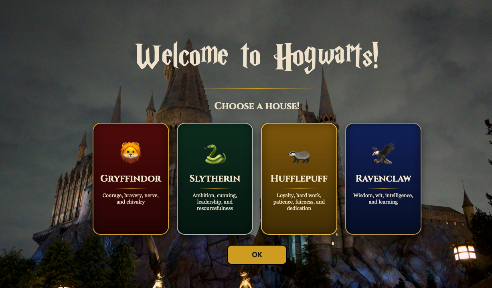
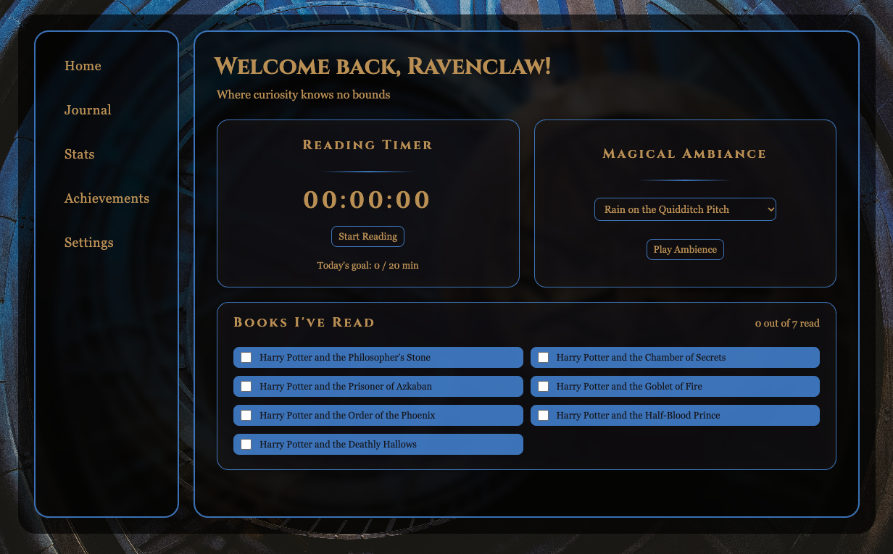
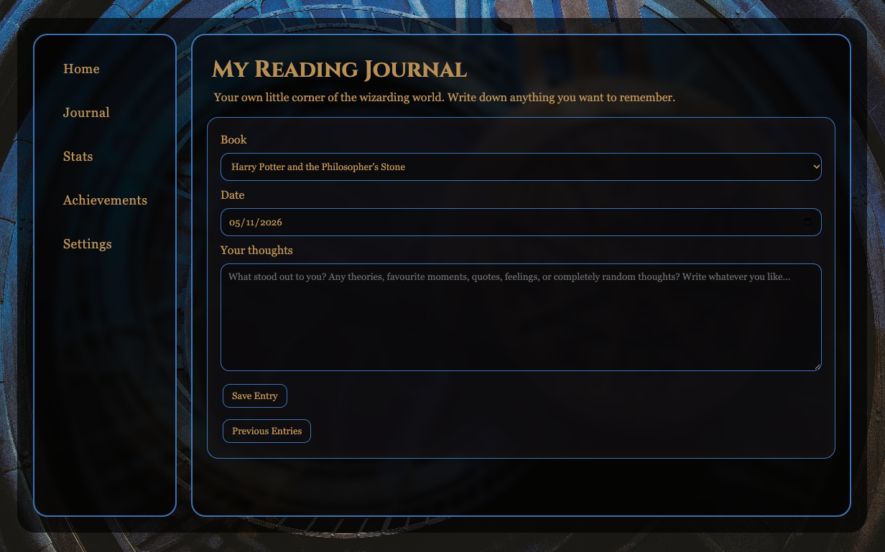
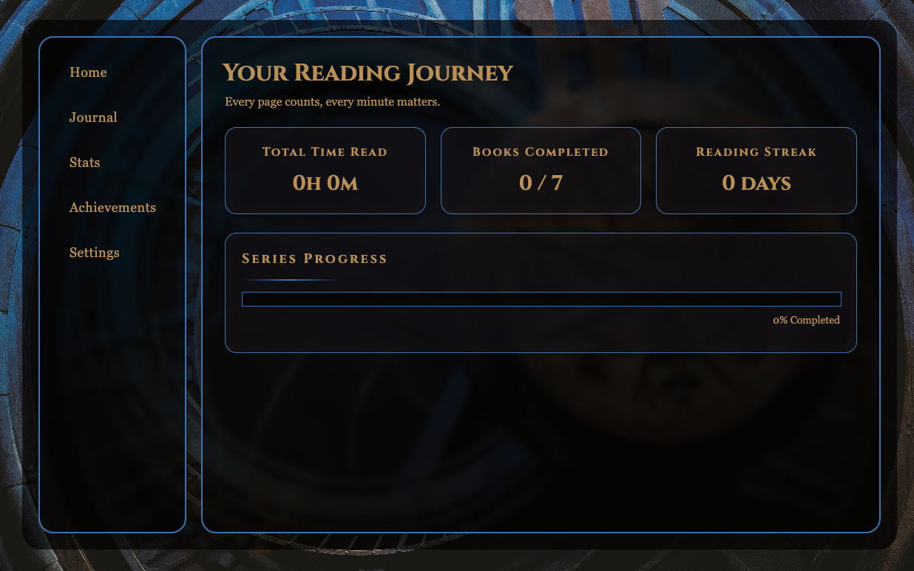
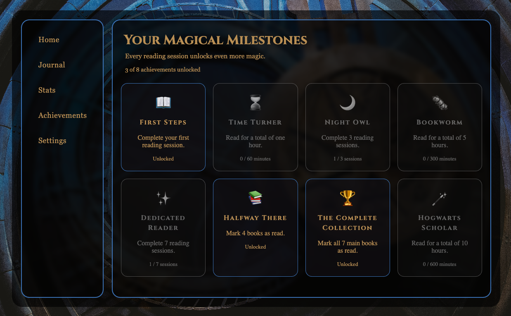
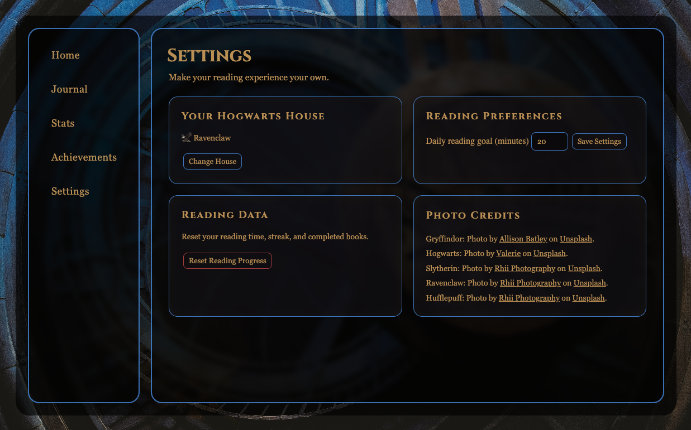

# Harry Potter Reading Companion

The Harry Potter Reading Companion is a reading tracker inspired by the Wizarding World, designed to make reading the seven Harry Potter books more fun and engaging.

Instead of simply keeping track of which books you've read, the website gives you a place to track your reading sessions, set goals, write down your thoughts, unlock achievements, and follow your progress throughout the series.

The goal is to make reading feel a little more magical, while encouraging readers to spend less time on their phones.

## Features

- Hogwarts House selection
- House-specific colours and themes
- Reading progress tracking for all seven books
- Reading timer with start, pause, resume and reset controls
- Reading session saving
- Daily reading goals
- Reading journal
  - Create journal entries
  - Select the book and date
  - Edit previous entries
  - Delete entries
- Reading statistics
  - Total reading time
  - Number of reading sessions
  - Completed books
- Achievement system
  - Unlockable achievements
  - Locked and unlocked achievement states
- Background music and ambient sounds
- Settings page
  - View and change Hogwarts House
  - Set daily reading goals
  - Reset reading progress

## Interface

The website uses a Hogwarts-inspired design, with dark backgrounds, warm colours, golden accents and the Cinzel font to create a magical atmosphere.

The interface is divided into several pages, each with its own purpose.

## Home Page

The Home page is the main dashboard of the Reading Companion.

It includes the reading timer, book progress checklist and background music controls, allowing users to start reading and track their progress without navigating through multiple pages.

## Journal

The Journal provides a place to write down thoughts, favourite moments, theories and anything else about the books.

Users can create entries by selecting a book, choosing a date and writing their notes.

Previous entries can be viewed, edited or deleted at any time.

## Statistics

The Statistics page displays information about the user's reading progress.

It includes:
- Total reading time
- Number of reading sessions
- Completed books
- Overall reading progress

## Achievements

The Achievements page contains different milestones that users can unlock as they read.

Achievements are connected to reading activity, such as total reading time, completed sessions and finished books.

Locked achievements are displayed differently from unlocked ones.

## Settings

The Settings page allows users to manage their reading experience.

Users can:
- View their selected Hogwarts House
- Change their Hogwarts House
- Set a daily reading goal
- Reset their reading progress

## How It Works

The website is built using HTML, CSS and JavaScript.

It uses JavaScript to handle the reading timer, journal entries, achievements, statistics and interactions throughout the website.

LocalStorage is used to save information directly in the browser, including reading progress, selected house, journal entries and reading goals.

This means the user's data remains available when they close and reopen the website, without requiring an account or database.

## Design

The design is inspired by the Harry Potter universe and the atmosphere of Hogwarts.

Each Hogwarts House has its own colour scheme, which is used throughout the interface. The website also uses dark translucent cards, golden accents and serif typography to create a consistent look across all pages.

I wanted all the pages to feel like different parts of the same application rather than separate websites.

## Deployment

The website is hosted using GitHub Pages.

It is built directly from the repository's main branch and can be accessed through a browser without installing anything.

[Open the Harry Potter Reading Companion](https://harfprofour12.github.io/HP_Reading_Buddy/)

## Built With

- HTML
- CSS
- JavaScript
- LocalStorage
- Git and GitHub
- GitHub Pages
- VS Code

## AI Usage

I used AI throughout development, mainly for:

- **Debugging:** Finding and fixing JavaScript and CSS errors.
- **CSS:** Getting help with layouts, spacing, styling and visual improvements.
- **JavaScript:** Understanding functions and implementing certain features.
- **Design:** Creating background images for the website.

The project idea, feature decisions, overall design direction, testing and development were done by me.

## Current Status

The website is deployed using GitHub Pages and most of its main features have been implemented.

What I've worked on so far:

- Hogwarts House selection
- House-specific themes
- Reading progress tracking
- Reading timer
- Reading session saving
- Reading journal
- Journal entry editing and deletion
- Statistics page
- Achievements page
- Daily reading goals
- Background music
- Settings page
- LocalStorage integration
- Responsive styling and layout improvements
- GitHub Pages deployment

Things I still want to work on:

- More testing
- Checking that all statistics are accurate
- Testing all achievement unlock conditions
- Making sure daily reading goals work correctly throughout the app
- Additional UI improvements

## Created for Hack Club's Stardance

This project was created as part of Hack Club Stardance, an event encouraging young people to build and ship their own projects.

---

**Made by Harry Fanouriakis**
